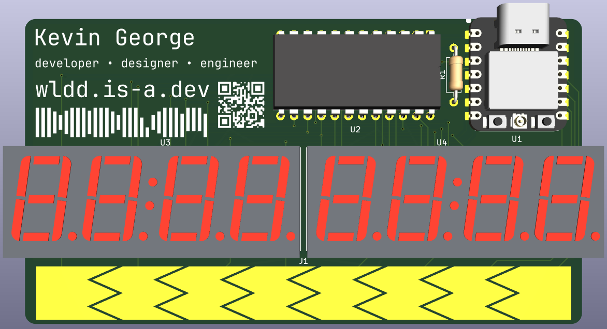
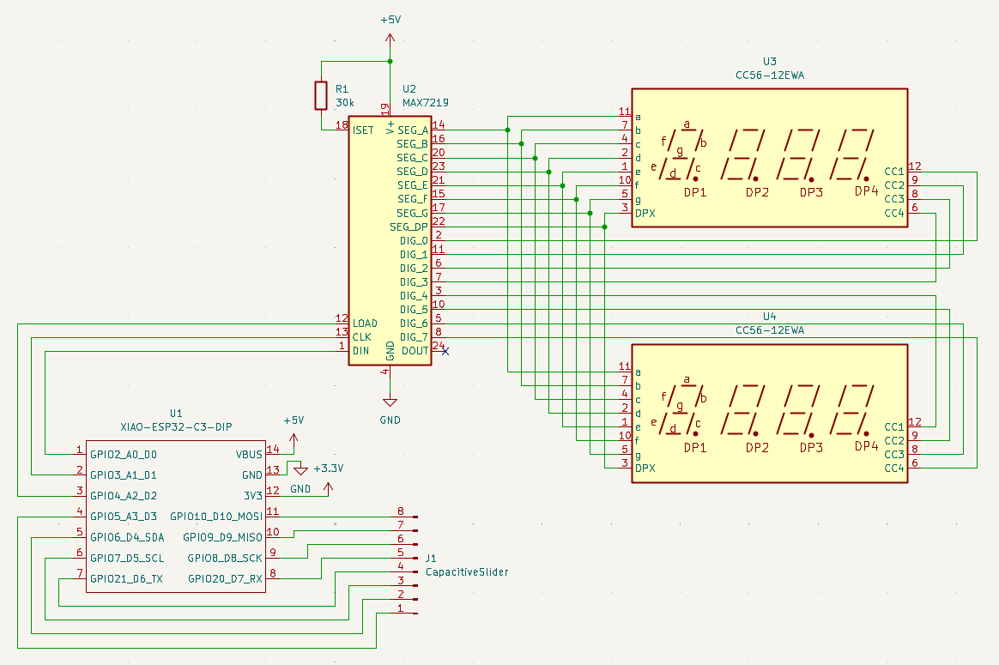
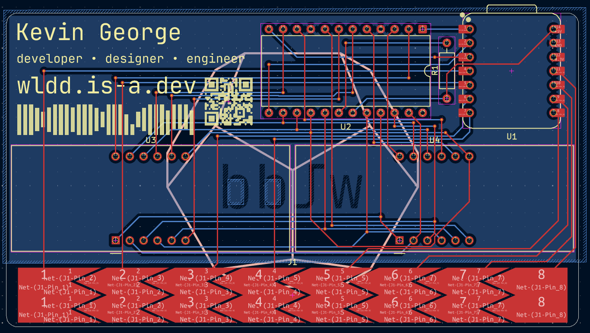

# Dodeca Card

A stylised business card with segmented displays and a capacitive slider.

## Details
PCB made in **KiCad** 
Firmware uses **CircuitPython**

**Components**:
- **Seeed Studio XIAO ESP32C3**: Microcontroller
- **MAX7219-HLF-5V**: Display Driver IC
- **0.56 inch 4 Digit 7 Segment Display**: Segmented displays
- **MCMF006FF3002A50**: Through Hole Resistor

**Features**:
- **8 seven-segment digits**, in two sets, connected via a MAX7219 driver
- 8 step **capacitive touch** slider

## About
This project, inspired by [Mitxela's StyloCard](https://mitxela.com/projects/stylocard),
was originally made for week 4 (Display week) of Hack Club's Half Life. I wanted to make
a compact board with stylised graphics on it and a simple display that could show live
values or text updating, like a countdown, an RSS feed, or Github stars.

The touch slider at the bottom of the board acts as a multi-purpose input. It can be used
to scroll through text, select/change options, or adjust values smoothly. It has 8 steps,
corresponding to the 8 digits on the display, meaning it can also be used to individually
target digits on the display.

## Images

### Schematic

### PCB Routing

